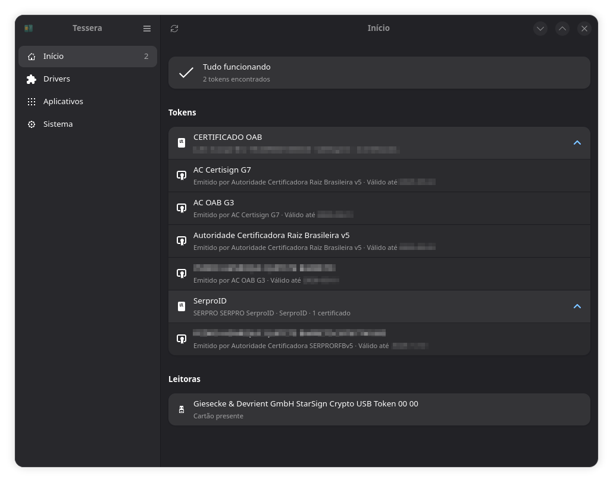

# Tessera

**[Português](#português)** · **[English](#english)**

---

## Português

O Tessera é uma central de tokens para Flatpak. Ele faz o token A3 ou o certificado em nuvem funcionar nos aplicativos em Flatpak, como o PJeOffice Pro e os navegadores, **sem instalar nenhum pacote de fornecedor no sistema**. Foi feito pensando nos sistemas imutáveis (Bluefin, Aurora, Bazzite, Fedora Silverblue e Kinoite), em que instalar o `.deb` ou o `.rpm` do fabricante do token é difícil ou impossível. Funciona também nas distribuições comuns e com os aplicativos instalados por elas.

*Tessera* era, em latim, a pequena peça que identificava quem a portava.

Estão incluídos:

1. o driver **SafeSign**, necessário para o token GD Burti, atualmente o mais usado pela advocacia;
2. o driver **SafeNet**, necessário para o token SafeNet 5100, o segundo mais usado pela advocacia;
3. o driver **SerproID**, necessário para o certificado digital em nuvem do Serpro, com o aplicativo SerproID;
4. o **Token Administration** do SafeSign, para trocar e desbloquear o PIN.

Os tokens ficam disponíveis para estes aplicativos, em Flatpak ou instalados pela distribuição:

| Aplicativo | Para quê |
|---|---|
| PJeOffice Pro | assinar no PJe |
| Firefox, Chromium, Google Chrome, Microsoft Edge e Brave | entrar com certificado em sites como Projudi e eproc |
| Papers e Okular | assinar PDF e conferir assinaturas |



---

### Distribuições

| Distribuição | Situação |
|---|---|
| Fedora, Bluefin, Aurora, Bazzite, Silverblue e Kinoite | funciona |
| Arch Linux, Manjaro, BigLinux, EndeavourOS e CachyOS | funciona |
| openSUSE Tumbleweed | funciona |
| Ubuntu 26.04 ou mais novo | funciona |
| **Debian 12 e 13, LMDE 6 e 7, Ubuntu 24.04, Linux Mint 22** | **não funciona:** use o [distrobox-adv-br](https://github.com/pedrohqb/distrobox-adv-br) |

O que decide é a versão do p11-kit do sistema. Com a 0.25.5 ou anterior, o Tessera mostra os tokens e o PIN é pedido, mas **a assinatura falha** (no navegador, `SSL_ERROR_HANDSHAKE_FAILED`): na 0.25.6, o p11-kit mudou a forma de transmitir os parâmetros da assinatura, e as versões anteriores não se entendem com o Tessera nesse ponto. Na família Debian, a versão aparece em `dpkg -l libp11-kit0`. Nos sistemas da tabela que não funcionam, a janela do Tessera mostra um aviso no topo.

---

### Instalação

#### 1. Preparar o sistema (uma vez)

O sistema precisa do Flatpak, do serviço de cartões (`pcscd`) com o driver CCID e do servidor p11-kit do usuário, que é o que deixa os aplicativos verem os tokens do Tessera. Rode os comandos da sua distribuição.

**Fedora, Bluefin, Aurora, Bazzite, Silverblue e Kinoite** (os pacotes já vêm instalados):

```bash
sudo systemctl enable --now pcscd.socket
systemctl --user enable --now p11-kit-server.socket
```

Se algum pacote tiver sido removido, reinstale-o com `sudo dnf install pcsc-lite pcsc-lite-ccid p11-kit-server`.

**Arch Linux, Manjaro, BigLinux, EndeavourOS e CachyOS:**

```bash
sudo pacman -S flatpak pcsclite ccid
sudo systemctl enable --now pcscd.socket
systemctl --user enable --now p11-kit-server.socket
```

**openSUSE Tumbleweed:**

```bash
sudo zypper in flatpak pcsc-ccid p11-kit-server
sudo systemctl enable --now pcscd.socket
systemctl --user enable --now p11-kit-server.socket
```

**Ubuntu 26.04 ou mais novo.** O pacote do p11-kit traz o servidor, mas não o `p11-kit-server.socket`. O servidor entra como um serviço comum do usuário, que sobe no login:

```bash
sudo apt install flatpak pcscd libccid p11-kit
sudo systemctl enable --now pcscd.socket
mkdir -p ~/.config/systemd/user
cat > ~/.config/systemd/user/p11-kit-server.service <<'EOF'
[Unit]
Description=p11-kit server
Documentation=man:p11-kit(8)

[Service]
ExecStartPre=/bin/mkdir -p -m 700 %t/p11-kit
ExecStart=/usr/bin/p11-kit server -f -n %t/p11-kit/pkcs11 pkcs11:
Restart=on-failure

[Install]
WantedBy=default.target
EOF
systemctl --user daemon-reload
systemctl --user enable --now p11-kit-server.service
```

A janela do Tessera também oferece o comando do servidor p11-kit, com um botão de copiar (no Ubuntu, numa linha só, que faz o mesmo).

#### 2. Instalar o Tessera

[](https://flatpark.org/apps/io.github.pedrohqb.Tessera)

O Tessera é distribuído pelo [FlatPark](https://flatpark.org), um repositório de Flatpaks. A base em que ele roda (o runtime do GNOME) vem do Flathub, e o Flatpak só a baixa de um repositório da **mesma instalação** do Tessera: de usuário (`--user`) ou de sistema (`--system`). Por isso os comandos abaixo adicionam os dois repositórios; se algum já estiver configurado, o `--if-not-exists` não muda nada.

Para instalar só para você:

```bash
flatpak --user remote-add --if-not-exists flathub https://dl.flathub.org/repo/flathub.flatpakrepo
flatpak --user remote-add --if-not-exists flatpark https://dl.flatpark.org/flatpark.flatpakrepo
flatpak --user install flatpark io.github.pedrohqb.Tessera
```

Para instalar para todos os usuários do computador (pede a senha de administrador):

```bash
flatpak --system remote-add --if-not-exists flathub https://dl.flathub.org/repo/flathub.flatpakrepo
flatpak --system remote-add --if-not-exists flatpark https://dl.flatpark.org/flatpark.flatpakrepo
flatpak --system install flatpark io.github.pedrohqb.Tessera
```

Funciona do mesmo jeito: cada usuário que abrir o Tessera tem a sua própria instância, com os seus tokens, e os passos de cada aplicativo continuam sendo por usuário.

Na instalação, o Flatpak baixa os drivers dos sites oficiais dos fornecedores e confere cada um pelo SHA256. As atualizações chegam com o `flatpak update`, como as dos outros aplicativos.

**Observação:** quem instalou antes uma versão de teste (o repositório `tessera-test`) deve tirá-la primeiro, sem apagar as configurações: `flatpak --user uninstall io.github.pedrohqb.Tessera && flatpak --user remote-delete tessera-test`.

---

### Uso

Abra o **Tessera** pelo menu de aplicativos. Com o token conectado, ele aparece em **Tokens**, com os seus certificados. O certificado SerproID aparece depois de você entrar pelo aplicativo SerproID, no botão da linha do driver.

A seção **Aplicativos** tem duas abas, **Flatpak** e **Nativos**. Cada aplicativo mostra o que falta e, quando tudo estiver certo, aparece como **Pronto**.

#### Aplicativos em Flatpak

São no máximo dois passos, feitos uma vez:

- **Passo 1 · acesso ao servidor p11-kit do sistema:** um comando para rodar no terminal, com botão de copiar. Por exemplo, para o Firefox:
  ```bash
  flatpak override --user --filesystem=xdg-run/p11-kit/pkcs11 org.mozilla.firefox
  ```
  Depois, feche o aplicativo e abra de novo.
- **Passo 2 · banco de certificados:** o botão **Configurar**. No Firefox, feche o navegador antes de apertar o botão.

| Aplicativo | Passos |
|---|---|
| PJeOffice Pro ([FlatPark](https://flatpark.org)) | nenhum: basta o servidor p11-kit da instalação |
| Firefox | passo 1 e passo 2 |
| Chromium, Chrome, Edge e Brave | só o passo 1 |
| Papers e Okular | passo 1 e passo 2 |

A linha **Conexão com o sistema** diz quantos tokens do Tessera os aplicativos estão vendo.

#### Aplicativos nativos

São os instalados pela própria distribuição (o Firefox em `.rpm` ou `.deb`, por exemplo). Eles não precisam da conexão com o sistema: chegam ao Tessera pelo `p11-kit-proxy.so`, e o único passo é o botão **Configurar**, que o acrescenta ao banco de certificados do aplicativo. Feche o aplicativo antes.

| Aplicativo nativo | Onde o Tessera configura |
|---|---|
| Firefox | todos os perfis |
| Chromium, Chrome, Edge e Brave | o banco que eles compartilham (`~/.pki/nssdb` ou `~/.local/share/pki/nssdb`) |
| Okular e Papers | nenhum botão próprio: usam o banco do perfil padrão do Firefox e ficam prontos quando o Firefox estiver configurado |
| PJeOffice Pro | a lista de bibliotecas A3 (`list.a3`) em `~/.pjeoffice-pro/pjeoffice-pro.config` |

No **Fedora e derivados**, o próprio sistema já carrega o p11-kit nos aplicativos nativos, que aparecem como **Pronto**, sem botão. Se o módulo do Tessera tiver sido acrescentado antes, cada token aparece duas vezes, e o botão vira **Retirar**, que tira só o do Tessera. O PJeOffice Pro não usa esse mecanismo e sempre precisa do seu **Configurar**.

#### Web PKI e WebSigner

O **Lacuna Web PKI** e o **Softplan WebSigner** são exigidos por alguns tribunais, como o e-SAJ.

- **Nos navegadores em Flatpak**, use o [**Sigillum**](https://github.com/pedrohqb/sigillum), que os instala e os liga aos tokens do Tessera.
- **Nos navegadores nativos**, use os pacotes oficiais dos fornecedores ([Web PKI](https://get.webpkiplugin.com/) e [WebSigner](https://websigner.softplan.com.br/)). Para que eles usem os tokens do Tessera, abra o plugin no navegador, vá em "Cripto Dispositivos" e, em "Opções personalizadas", acrescente o caminho do p11-kit da sua distribuição:

  | Distribuição | Caminho |
  |---|---|
  | Fedora e openSUSE | `/usr/lib64/p11-kit-proxy.so` |
  | Ubuntu | `/usr/lib/x86_64-linux-gnu/p11-kit-proxy.so` |
  | Arch e derivados | `/usr/lib/p11-kit-proxy.so` (ou `/lib/libp11-kit.so`, que é a mesma biblioteca) |

#### Em segundo plano

- **Fechar a janela não desliga o Tessera:** os tokens continuam disponíveis, e um ícone na bandeja mostra o resumo. No GNOME, o ícone depende da extensão AppIndicator, que o Bluefin e o Aurora já trazem. Para tirar o ícone, use o menu ☰ → **Mostrar ícone na bandeja**.
- **Sair**, pelo menu ou pela bandeja, desliga o Tessera, e os tokens deixam de aparecer nos aplicativos.
- **Para o Tessera abrir sozinho ao entrar na sessão,** use o menu ☰ → **Iniciar automaticamente no login**.

#### Se algo não funcionar

- **A linha "Conexão com o sistema" está vermelha:** o servidor p11-kit do sistema está desligado. Rode o comando do passo 1 da instalação, ou copie-o pelo botão da própria linha. Ela volta ao normal sozinha em alguns segundos.
- **O aplicativo não vê o token:** confira se ele está como **Pronto** na lista e se foi aberto de novo depois do passo 1.
- **O token não aparece no Tessera:** tire e ponha o token. Se um driver aparecer como "Parado", aperte **Reiniciar**.
- **O PIN é pedido, mas a assinatura falha:** confira a versão do p11-kit (veja [Distribuições](#distribuições)).
- **Um navegador pede o PIN duas vezes:** veja [Aplicativos](docs/apps.md#chromium-google-chrome-microsoft-edge-and-brave).

Mais casos em [Troubleshooting](docs/troubleshooting.md) (em inglês).

---

### Desinstalação

Saia do Tessera (menu ☰ → **Sair**) e rode:

```bash
flatpak uninstall --user --delete-data io.github.pedrohqb.Tessera
```

Numa instalação de sistema, troque `--user` por `--system`.

A permissão do passo 1 de cada aplicativo é desfeita com `flatpak override --user --reset <aplicativo>`. Esse comando também apaga outras permissões que você tenha dado ao aplicativo.

---

### A fazer

- **Novos aplicativos:**
  - LibreOffice, Thunderbird e Evolution, em Flatpak e nativos, pelo banco de certificados de cada um;
  - JSignPdf, apontado para o p11-kit, como o PJeOffice Pro;
  - Assinador SERPRO, que depende antes de um Flatpak próprio.
- **Novo driver:** OpenSC, que é software livre e atende tokens como o ePass2003.

---

### Documentação

A documentação técnica, em inglês, está em [docs/](docs/README.md):

- **[Architecture](docs/architecture.md):** como o token sai do sandbox do Tessera e chega aos aplicativos, e por que não há caminho mais simples.
- **[Drivers](docs/drivers.md):** origem e verificação de cada driver, e o que foi preciso ajustar, sobretudo no SerproID.
- **[Apps](docs/apps.md):** o que cada aplicativo precisa e por quê.
- **[Installation and usage](docs/usage.md):** a janela, a bandeja e a linha de comando.
- **[Compatibility](docs/compatibility.md):** o que é conferido automaticamente a cada mudança e o que já foi testado à mão com tokens reais. Para acrescentar o seu teste, abra uma issue com o modelo "Compatibility report".
- **[Troubleshooting](docs/troubleshooting.md):** logs, ferramentas de teste e como investigar um problema.
- **[History](docs/history.md):** os problemas encontrados nos testes com tokens reais e como cada um foi resolvido.
- **[Development](docs/development.md):** compilação, testes, versões e como acrescentar um driver.

---

### Suporte

Havendo qualquer dificuldade, abra uma [issue](https://github.com/pedrohqb/tessera/issues) ou peça ajuda no grupo oficial no [Telegram](https://t.me/advogados_linux).

---

### Licença

GPL-3.0-or-later. Os drivers dos fornecedores não fazem parte do Tessera: são baixados dos fornecedores na instalação e seguem as licenças deles.

---

## English

Tessera is a token hub for Flatpak. It makes A3 tokens and cloud certificates work in Flatpak apps, such as PJeOffice Pro and web browsers, **without installing any vendor package on the system**. It was made with immutable systems in mind (Bluefin, Aurora, Bazzite, Fedora Silverblue and Kinoite), where installing a token vendor's `.deb` or `.rpm` is hard or impossible. It also works on regular distributions and with the apps they install.

*Tessera* was the Latin word for a small token that identified its bearer.

Included:

1. the **SafeSign** driver, for GD Burti tokens, currently the most used by Brazilian lawyers;
2. the **SafeNet** driver, for SafeNet 5100 tokens, the second most used;
3. the **SerproID** driver, for Serpro's cloud certificate, with the SerproID app;
4. SafeSign's **Token Administration**, to change and unlock the PIN.

The tokens are available to these apps, as Flatpaks or installed from the distribution:

| App | For |
|---|---|
| PJeOffice Pro | signing in PJe |
| Firefox, Chromium, Google Chrome, Microsoft Edge and Brave | certificate login on sites such as Projudi and eproc |
| Papers and Okular | signing PDFs and checking signatures |

### Distributions

| Distribution | Status |
|---|---|
| Fedora, Bluefin, Aurora, Bazzite, Silverblue and Kinoite | works |
| Arch Linux, Manjaro, BigLinux, EndeavourOS and CachyOS | works |
| openSUSE Tumbleweed | works |
| Ubuntu 26.04 or newer | works |
| **Debian 12 and 13, LMDE 6 and 7, Ubuntu 24.04, Linux Mint 22** | **does not work:** use [distrobox-adv-br](https://github.com/pedrohqb/distrobox-adv-br) |

What decides it is the system's p11-kit version. With 0.25.5 or older, Tessera shows the tokens and the PIN is asked, but **signing fails** (in the browser, `SSL_ERROR_HANDSHAKE_FAILED`): in 0.25.6, p11-kit changed how it sends the signing parameters, and older versions do not understand Tessera on that point. On the Debian family, `dpkg -l libp11-kit0` shows the version. On the systems in the table that do not work, Tessera's window shows a warning at the top.

### Installation

#### 1. Prepare the system (once)

The system needs Flatpak, the smart card service (`pcscd`) with the CCID driver, and the user's p11-kit server, which is what lets apps see Tessera's tokens. Run the commands for your distribution.

**Fedora, Bluefin, Aurora, Bazzite, Silverblue and Kinoite** (the packages are already installed):

```bash
sudo systemctl enable --now pcscd.socket
systemctl --user enable --now p11-kit-server.socket
```

If a package was removed, reinstall it with `sudo dnf install pcsc-lite pcsc-lite-ccid p11-kit-server`.

**Arch Linux, Manjaro, BigLinux, EndeavourOS and CachyOS:**

```bash
sudo pacman -S flatpak pcsclite ccid
sudo systemctl enable --now pcscd.socket
systemctl --user enable --now p11-kit-server.socket
```

**openSUSE Tumbleweed:**

```bash
sudo zypper in flatpak pcsc-ccid p11-kit-server
sudo systemctl enable --now pcscd.socket
systemctl --user enable --now p11-kit-server.socket
```

**Ubuntu 26.04 or newer.** The p11-kit package ships the server but not `p11-kit-server.socket`. The server goes in as a plain user service, started at login:

```bash
sudo apt install flatpak pcscd libccid p11-kit
sudo systemctl enable --now pcscd.socket
mkdir -p ~/.config/systemd/user
cat > ~/.config/systemd/user/p11-kit-server.service <<'EOF'
[Unit]
Description=p11-kit server
Documentation=man:p11-kit(8)

[Service]
ExecStartPre=/bin/mkdir -p -m 700 %t/p11-kit
ExecStart=/usr/bin/p11-kit server -f -n %t/p11-kit/pkcs11 pkcs11:
Restart=on-failure

[Install]
WantedBy=default.target
EOF
systemctl --user daemon-reload
systemctl --user enable --now p11-kit-server.service
```

Tessera's window also offers the p11-kit server command, with a copy button (on Ubuntu, as a single line that does the same).

#### 2. Install Tessera

[](https://flatpark.org/apps/io.github.pedrohqb.Tessera)

Tessera is distributed through [FlatPark](https://flatpark.org), a Flatpak remote. The base it runs on (the GNOME runtime) comes from Flathub, and Flatpak only downloads it from a remote in the **same installation** as Tessera: the user's (`--user`) or the system's (`--system`). So the commands below add both remotes; if one is already set up, `--if-not-exists` leaves it as it is.

To install for yourself only:

```bash
flatpak --user remote-add --if-not-exists flathub https://dl.flathub.org/repo/flathub.flatpakrepo
flatpak --user remote-add --if-not-exists flatpark https://dl.flatpark.org/flatpark.flatpakrepo
flatpak --user install flatpark io.github.pedrohqb.Tessera
```

To install for every user of the computer (asks for the administrator password):

```bash
flatpak --system remote-add --if-not-exists flathub https://dl.flathub.org/repo/flathub.flatpakrepo
flatpak --system remote-add --if-not-exists flatpark https://dl.flatpark.org/flatpark.flatpakrepo
flatpak --system install flatpark io.github.pedrohqb.Tessera
```

It works the same way: each user who opens Tessera gets their own instance, with their own tokens, and each app's steps are still per user.

During installation, Flatpak downloads the drivers from the vendors' official sites and checks each one against its SHA256. Updates come with `flatpak update`, like any other app.

**Note:** if you installed a test build before (the `tessera-test` remote), remove it first, keeping your settings: `flatpak --user uninstall io.github.pedrohqb.Tessera && flatpak --user remote-delete tessera-test`.

### Usage

Open **Tessera** from the app menu. With the token plugged in, it appears under **Tokens**, with its certificates. The SerproID certificate appears after you sign in through the SerproID app, with the button on the driver's row.

The **Apps** section has two tabs, **Flatpak** and **Native**. Each app shows what is missing and, when everything is right, shows as **Ready**.

#### Flatpak apps

There are at most two steps, done once:

- **Step 1 · access to the system's p11-kit server:** a command to run in a terminal, with a copy button. For Firefox, for example:
  ```bash
  flatpak override --user --filesystem=xdg-run/p11-kit/pkcs11 org.mozilla.firefox
  ```
  Then close the app and open it again.
- **Step 2 · certificate database:** the **Set up** button. For Firefox, close the browser before pressing the button.

| App | Steps |
|---|---|
| PJeOffice Pro ([FlatPark](https://flatpark.org)) | none: the p11-kit server from the installation is enough |
| Firefox | step 1 and step 2 |
| Chromium, Chrome, Edge and Brave | step 1 only |
| Papers and Okular | step 1 and step 2 |

The **System connection** row tells how many of Tessera's tokens the apps see.

#### Native apps

These are the apps installed from the distribution itself (Firefox as an `.rpm` or `.deb`, say). They need no system connection: they reach Tessera through `p11-kit-proxy.so`, and the only step is the **Set up** button, which adds it to the app's certificate database. Close the app first.

| Native app | Where Tessera sets it up |
|---|---|
| Firefox | every profile |
| Chromium, Chrome, Edge and Brave | the database they share (`~/.pki/nssdb` or `~/.local/share/pki/nssdb`) |
| Okular and Papers | no button of their own: they use the default Firefox profile's database, and are ready once Firefox is set up |
| PJeOffice Pro | the list of A3 libraries (`list.a3`) in `~/.pjeoffice-pro/pjeoffice-pro.config` |

On **Fedora and its derivatives**, the system itself already loads p11-kit in native apps, which show as **Ready**, with no button. If Tessera's module was added earlier, each token shows twice, and the button becomes **Remove**, which takes out only Tessera's. PJeOffice Pro does not use that mechanism and always needs its own **Set up**.

#### Web PKI and WebSigner

**Lacuna Web PKI** and **Softplan WebSigner** are required by some courts (e-SAJ, for example).

- **In Flatpak browsers**, use [**Sigillum**](https://github.com/pedrohqb/sigillum), which installs them and connects them to Tessera's tokens.
- **In native browsers**, use the vendors' official packages ([Web PKI](https://get.webpkiplugin.com/) and [WebSigner](https://websigner.softplan.com.br/)). For them to use Tessera's tokens, open the plugin in the browser, go to "Cripto Dispositivos" and, under "Opções personalizadas", add your distribution's p11-kit path:

  | Distribution | Path |
  |---|---|
  | Fedora and openSUSE | `/usr/lib64/p11-kit-proxy.so` |
  | Ubuntu | `/usr/lib/x86_64-linux-gnu/p11-kit-proxy.so` |
  | Arch and derivatives | `/usr/lib/p11-kit-proxy.so` (or `/lib/libp11-kit.so`, the same library) |

#### In the background

- **Closing the window does not stop Tessera:** the tokens stay available, and a tray icon shows a summary. On GNOME, the icon needs the AppIndicator extension, which Bluefin and Aurora ship. To remove the icon, use the ☰ menu → **Show an icon in the tray**.
- **Quit**, from the menu or the tray, stops Tessera, and the tokens disappear from the apps.
- **To have Tessera start when you log in,** use the ☰ menu → **Start automatically at login**.

#### If something does not work

- **The "System connection" row is red:** the system's p11-kit server is off. Run the command from installation step 1, or copy it with the row's own button. The row goes back to normal by itself in a few seconds.
- **An app does not see the token:** check that it shows as **Ready** in the list, and that it was opened again after step 1.
- **The token does not appear in Tessera:** unplug it and plug it in again. If a driver shows as "Stopped", press **Restart**.
- **The PIN is asked, but signing fails:** check the p11-kit version (see [Distributions](#distributions)).
- **A browser asks for the PIN twice:** see [Apps](docs/apps.md#chromium-google-chrome-microsoft-edge-and-brave).

More cases in [Troubleshooting](docs/troubleshooting.md).

### Uninstalling

Quit Tessera (☰ menu → **Quit**) and run:

```bash
flatpak uninstall --user --delete-data io.github.pedrohqb.Tessera
```

For a system-wide install, use `--system` instead of `--user`.

Each app's step 1 permission is undone with `flatpak override --user --reset <app>`. That command also removes any other permission you gave the app.

### To do

- **New apps:**
  - LibreOffice, Thunderbird and Evolution, as Flatpaks and native, through each one's certificate database;
  - JSignPdf, pointed at p11-kit, like PJeOffice Pro;
  - Assinador SERPRO, which first needs a Flatpak of its own.
- **New driver:** OpenSC, which is free software and supports tokens such as the ePass2003.

### Documentation

The technical documentation is in [docs/](docs/README.md):

- **[Architecture](docs/architecture.md):** how a token leaves Tessera's sandbox and reaches the apps, and why there is no simpler way.
- **[Drivers](docs/drivers.md):** where each driver comes from, how it is checked, and what had to be adjusted, above all for SerproID.
- **[Apps](docs/apps.md):** what each app needs, and why.
- **[Installation and usage](docs/usage.md):** the window, the tray and the command line.
- **[Compatibility](docs/compatibility.md):** what is checked automatically on every change, and what has been tested by hand with real tokens. To add your test, open an issue with the "Compatibility report" template.
- **[Troubleshooting](docs/troubleshooting.md):** logs, test tools and how to investigate a problem.
- **[History](docs/history.md):** the problems found while testing with real tokens, and how each was solved.
- **[Development](docs/development.md):** building, tests, releases and how to add a driver.

### Support

If you have any trouble, open an [issue](https://github.com/pedrohqb/tessera/issues) or ask in the [Telegram](https://t.me/advogados_linux) group (in Portuguese).

### License

GPL-3.0-or-later. The vendor drivers are not part of Tessera: they are downloaded from their vendors at installation and are covered by the vendors' own licenses.
