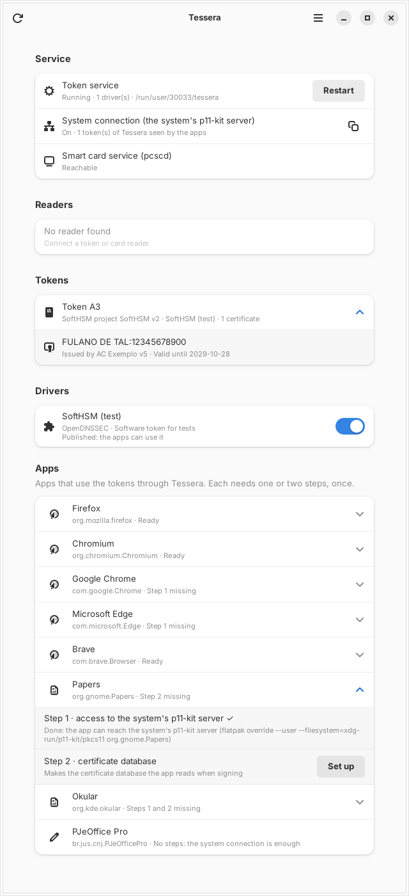

# Tessera

**A PKCS#11 token hub for Flatpak.** Tessera runs the drivers for hardware tokens, smart cards and cloud certificates inside its own sandbox, and shares the tokens with your other apps through [p11-kit](https://p11-glue.github.io/p11-glue/p11-kit.html). No vendor driver package is installed on the system. That makes it useful on immutable systems (Fedora Silverblue and Kinoite, Bluefin, Aurora, Bazzite), where installing a vendor's driver package on the host is hard or impossible.

*Tessera* was the Latin word for a small token that identified its bearer.



## How it works

```
Token ─► pcscd (host) ─► Tessera sandbox: one p11-kit server per driver
                          $XDG_RUNTIME_DIR/tessera/{safesign,safenet,serproid}
                                         ▲  "remote:" lines in
                                         │  ~/.config/pkcs11/modules/tessera-*.module
Host: p11-kit-server.socket ($XDG_RUNTIME_DIR/p11-kit/pkcs11) ─ host trust store, host modules (OpenSC…)
                                         ▲
               ┌─────────────────────────┼─────────────────────────┐
   PJeOffice Pro · Firefox · Chromium · Chrome · Edge · Brave · Papers · Okular
  (each: --filesystem=xdg-run/p11-kit/pkcs11, loads p11-kit-client.so)
```

1. Tessera starts one `p11-kit server --provider <driver>` per installed driver, each on its own socket in `$XDG_RUNTIME_DIR/tessera/`.
2. For each driver, it writes a module file into the host's `~/.config/pkcs11/modules/` containing `remote: unix:path=…/tessera/<driver>`. The host's p11-kit now includes those tokens with its own modules: the trust store, plus OpenSC if the system has it.
3. The host's own p11-kit server (`p11-kit-server.socket`, enabled once) serves all of that on `$XDG_RUNTIME_DIR/p11-kit/pkcs11`.
4. Sandboxed apps reach that socket with `--filesystem=xdg-run/p11-kit/pkcs11` and load the runtime's `p11-kit-client.so`. FlatPark's PJeOffice Pro already does exactly this. Native apps (a distribution's own Firefox, say) see the tokens through `p11-kit-proxy.so`.

**Why not inside the sandbox?** Flatpak puts `user-config: none` into every sandbox's `/etc/pkcs11/pkcs11.conf`, and replaces `$XDG_RUNTIME_DIR/p11-kit` with its own trust-store server. So no sandboxed process can load a custom p11-kit configuration or serve on the default socket. One server per driver needs no configuration, and the host's p11-kit does the joining.

The window shows the service, the system connection, the card readers, the tokens with their certificates, and the drivers, each with its state, an on/off switch and buttons for the vendors' tools. It also sets up Firefox, Chromium, Chrome, Edge, Brave, Papers and Okular. The service keeps running when the window is closed, with an icon in the tray (StatusNotifierItem; on GNOME through the AppIndicator extension, which Bluefin and Aurora ship), and it can start at login (menu → *Start automatically at login*).

Each driver is listed, and published to the host only while it answers. One that stops answering is restarted, and stopped after three times in a row so it cannot hang the apps.

**Full documentation (in Portuguese): [docs/](docs/README.md)**: architecture, every driver and its quirks, each app, troubleshooting tools, and the history of what was found while testing with real tokens.

## Drivers

| Driver | Tokens | Source |
|---|---|---|
| SafeSign IC (A.E.T.) | GD Burti and other SafeSign tokens | Vendor `.deb` (PKCS#11 libraries) and `.rpm` (Token Administration) |
| SafeNet Authentication Client (Thales) | SafeNet eToken 5100/5110, IDPrime | Vendor `.zip` ("withoutUI" core package) |
| SerproID (Serpro) | Serpro cloud certificate | Vendor `.deb` (with its own Java) |

The drivers use Flatpak's *extra-data*: each vendor file is downloaded from the vendor at install time and checked against the sha256 pinned in the manifest. These are the same pins as [distrobox-adv-br](https://github.com/pedrohqb/distrobox-adv-br). Each package is unpacked into its own directory, and **no maintainer script runs**. As in distrobox-adv-br, the packages' `/etc` is dropped, and SerproID's module is also offered as `libneoidp11.so`. The dependencies follow the vendors' packages and the AUR packages (`safesignidentityclient`, `sac-core`, `serproid`):

- SafeSign's `libaetpkss.so` needs GDBM, which the runtime lacks; it comes from Ubuntu 24.04's `libgdbm6t64` and `libgdbm-compat4t64`.
- SafeSign's Token Administration is taken from the vendor's RHEL 10 package, which needs no wxWidgets.
- The paths in SerproID's launcher script are pointed at Tessera's copy.

A driver that fails to unpack is listed as missing; the others keep working.

There's no bundled OpenSC: if the system has it (Fedora and Universal Blue do), the host's p11-kit serves it to the same apps.

More drivers can be added without changing Tessera. A driver is a directory with a `driver.toml`:

```toml
name = "Example Token"
vendor = "Example Inc."
description = "What it is for"
module = "lib/libexample-pkcs11.so"     # absolute, or relative to this directory
library_path = ["lib"]                  # optional: LD_LIBRARY_PATH for the module
create_dirs = ["~/.config/example"]     # optional

[[tools]]                               # optional: buttons in the window
name = "Token Manager"
exec = ["bin/token-manager"]
```

Bundled drivers live in `/app/lib/tessera/drivers/<id>/`. Driver extensions, named `io.github.pedrohqb.Tessera.Driver.<Name>`, are mounted in `/app/lib/tessera/extensions/<Name>/`.

## Setup on the host (once)

- `pcscd` running, plus the `ccid` driver. Most distributions ship both; Fedora atomic and Universal Blue images include them.
- The host's p11-kit server. Tessera's window shows this command with a copy button:
  ```sh
  systemctl --user enable --now p11-kit-server.socket
  ```
  On Fedora-based systems the unit comes in the `p11-kit-server` package.

Tessera writes and updates the `tessera-*.module` files itself, through its `xdg-config/pkcs11` permission, and touches no other file there.

## Client apps

**PJeOffice Pro** ([FlatPark](https://flatpark.org), `br.jus.cnj.PJeOfficePro`): nothing to do. It already has `xdg-run/p11-kit/pkcs11` and loads `p11-kit-client.so`.

**Firefox** (`org.mozilla.firefox`):
1. Let it reach the host's p11-kit server (the copy button in Tessera gives the command):
   ```sh
   flatpak override --user --filesystem=xdg-run/p11-kit/pkcs11 org.mozilla.firefox
   ```
2. Close Firefox. In Tessera, press *Set up* and choose the profile folder. Or, in Firefox: *Settings → Privacy & Security → Security Devices → Load*, module file `/usr/lib/x86_64-linux-gnu/pkcs11/p11-kit-client.so`.

**Chromium, Google Chrome, Microsoft Edge, Brave** (`org.chromium.Chromium`, `com.google.Chrome`, `com.microsoft.Edge`, `com.brave.Browser`):
1. The same override.
2. Nothing else: Chromium loads the root-certificates module (`libnssckbi.so`) by itself, and in the Flatpak runtime that is p11-kit, which reaches the host's server. *Set up* only removes the `p11-kit-client.so` an older Tessera registered in the browser's NSS database (since Chromium 146, `~/.var/app/<id>/data/pki/nssdb`; an older `~/.pki/nssdb` wins if it exists), which made every token show twice and the PIN be asked twice.

**Papers** (`org.gnome.Papers`):
1. ```sh
   flatpak override --user --filesystem=xdg-run/p11-kit/pkcs11 org.gnome.Papers
   ```
2. In Tessera, press *Set up*. This creates an empty NSS database at `~/.var/app/org.gnome.Papers/config/mozilla/firefox/tessera.default`, which is the first place Papers (through poppler) looks for signing certificates. No module is registered in it: when NSS opens a database it loads the root-certificates module by itself, and in the Flatpak runtime that is p11-kit, which reaches the system's p11-kit server through the permission above. (Registering `p11-kit-client.so` as well would show every certificate twice; Tessera removes that entry if an earlier version added it.)

**Okular** (`org.kde.okular`): the same two steps as Papers (it signs through poppler too); the database goes to `~/.var/app/org.kde.okular/config/mozilla/firefox/tessera.default`.

The host's p11-kit server serves the host's trust store as well, so these apps keep the system's certificates.

## Command line

```
tessera                     open the window (and start the token service)
tessera --background        start the token service without a window
tessera serve               run only the token service, in the foreground
tessera status              print drivers, readers, tokens and whether apps see them
tessera nss-setup DIR       register p11-kit-client.so in the NSS database DIR
```

For development, these environment variables override the defaults: `TESSERA_DRIVERS_PATH` (driver directories, separated by `:`), `TESSERA_SOCKET_DIR`, `TESSERA_HOST_MODULES`, `TESSERA_P11KIT_SERVER` (p11-kit's `p11-kit-server` helper) and `TESSERA_CLIENT_MODULE` (the client module `status` and `list-tokens` load).

## Building

```sh
# Flatpak build (fills in the drivers' sizes after checking their sha256):
python3 scripts/pin-drivers.py
flatpak-builder --user --install-deps-from=flathub --force-clean --install build-dir flatpak/io.github.pedrohqb.Tessera.yml

# Development build (needs GTK 4, libadwaita and pcsc-lite development files):
cargo build
TESSERA_DRIVERS_PATH=/path/to/drivers cargo run
```

Every push to `main` builds a test build in GitHub Actions: `tessera-repo.tar.gz`, a small Flatpak repository. A single-file `.flatpak` bundle can't carry the drivers' extra-data, which is why it isn't used. To install the test build:

```sh
tar -xzf tessera-repo.tar.gz
./install-test-repo.sh        # adds it as the local remote "tessera-test" and installs Tessera
```

Tagging `vX.Y.Z` publishes it, together with `tessera-x86_64.tar.gz`: the whole `/app` tree built against the GNOME runtime (Tessera, its data, the bundled libpcsclite), for packaging as extra-data.

## Status

First release. Tested on Bluefin with a GD Burti token (SafeSign) and a SerproID cloud certificate: signing in PJeOffice Pro, TLS client-certificate login in Firefox, PDF signing in Papers, and the vendors' tools. Chromium, Chrome, Edge, Brave and Okular are tested with SoftHSM only; SafeNet has not been tried with a real token. Reports are welcome.

SerproID needed two workarounds that may help anyone packaging it: it uses libgcc_s's unwinder without linking it (preloaded), and it keeps the `CK_MECHANISM` pointer from `C_SignInit` and reads the PSS parameters only in `C_Sign`, after p11-kit has reused that memory (Tessera hands it a copy that stays valid). Details in [docs/drivers.md](docs/drivers.md#serproid).

---

## Em português

A documentação completa, em português, está em [docs/](docs/README.md).

O **Tessera** é uma central de tokens para Flatpak. Ele roda os drivers dos tokens (SafeSign/GD Burti, SafeNet e SerproID) dentro do próprio sandbox, sem instalar pacotes de fornecedores no sistema. Foi feito pensando nos sistemas imutáveis (Bluefin, Silverblue, Aurora, Bazzite).

Os tokens chegam aos aplicativos (PJeOffice Pro, Firefox, Chromium, Chrome, Edge, Brave, Papers, Okular) pelo servidor p11-kit do próprio sistema. O Tessera grava um arquivo por driver em `~/.config/pkcs11/modules`, e basta ativar uma vez o `systemctl --user enable --now p11-kit-server.socket`. O PJeOffice Pro do FlatPark funciona sem nenhuma configuração. Os outros aplicativos precisam do `flatpak override` que a janela mostra e do botão "Configurar". Com a janela fechada, o Tessera continua servindo os tokens, com um ícone na bandeja.

Os drivers são baixados dos sites oficiais na instalação e conferidos pelo SHA256 fixado. Nenhum script de instalação do fornecedor é executado, seguindo a mesma "limpeza" do [distrobox-adv-br](https://github.com/pedrohqb/distrobox-adv-br).

## License

GPL-3.0-or-later. The vendor drivers are not part of Tessera: they are downloaded from their vendors and are covered by the vendors' own licenses.
